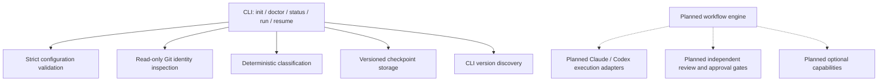
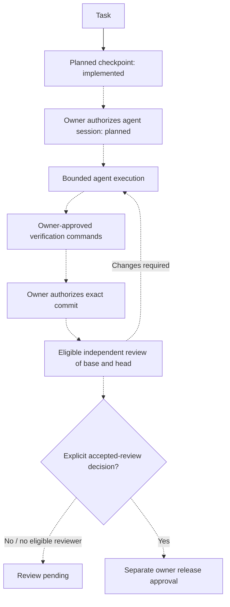

# Architecture and trust boundaries

SASQN is a single TypeScript package. The v0.1 vertical slice creates, validates, persists and reloads task plans. It does not execute agents or claim independent review acceptance.



## Current behavior

Classification is a conservative keyword heuristic, not a security decision. Unknown tasks never become automatically safe. Preferred-agent routing is explicit configuration; no speculative model-quality ranking is used.

Repository configuration is data only. Global preferences cannot bypass mandatory approvals. No verification command, Markdown instruction, package script, Git hook or integration is deliberately executed by init/run/resume. Diagnostics invoke trusted installed executables with `--version`; an executable's own behavior remains part of the local installation trust boundary.

Git inspection requires Git 2.36+ because older versions can treat `core.fsmonitor=false` as a hook command. Every inspection subprocess disables hooks through `core.hooksPath`, disables fsmonitor and paging, and disables transport protocols. No diff/textconv command is used. Discovery uses `rev-parse`, `symbolic-ref` and `show-ref`; path parsing removes exactly one LF and validates the canonical root/Git-directory pairing. Linked worktrees and separate Git directories remain supported.

Before reading working-tree status, SASQN enumerates effective configuration keys, including conditional includes and worktree configuration, and rejects any `filter.*`, `extensions.partialClone` or `remote.*.promisor` entry, even an unused/disabled one. It does not clear global/local configuration or change conversion semantics. It also asks Git to resolve `core.fileMode` as a Boolean with its default of true and rejects an effective false value before cleanliness inspection. This uses the same configuration sources and sanitized environment as status: global/system config file selectors are honored, while inline `GIT_CONFIG_COUNT`/`GIT_CONFIG_PARAMETERS` overrides remain removed. Filesystems requiring `core.fileMode=false` are unsupported. It then uses index-only `ls-files --stage -v -z --sparse` to reject hidden flags, sparse directories, gitlinks, unmerged entries and unrecognized records. For an existing HEAD, it also enumerates the resolved commit with `ls-tree -r -z --full-tree` and rejects gitlinks in that tree, including staged submodule deletions or replacements no longer visible in the index. This traverses only superproject tree objects; gitlinks remain leaves and their commit objects/checkouts are not inspected. Unborn branches skip this tree check. Status uses `--ignore-submodules=all` only after both gates pass. Sparse checkouts with skip-worktree entries are unsupported.

These are controls for this fixed inspection command set, not a sandbox for arbitrary Git commands. The installed Git executable and OS remain trusted. Concurrent hostile edits to Git configuration/index are outside the same-user trust boundary; no atomic snapshot is claimed. Malformed or non-UTF-8 output, command timeouts and output limits reject inspection. No caller can bypass the shared gate for init/status/run/resume.

Supporting Git documentation: [filter conversion](https://git-scm.com/docs/gitattributes), [configuration and hooks/fsmonitor](https://git-scm.com/docs/git-config), [index flags and NUL output](https://git-scm.com/docs/git-ls-files), [tree enumeration](https://git-scm.com/docs/git-ls-tree), [status submodule controls](https://git-scm.com/docs/git-status), and [transport restrictions](https://git-scm.com/docs/git).

Task creation and resume require a clean Git working tree. Git porcelain output covers staged, unstaged and untracked entries; v0.1 does not read their contents. Unsupported content inspection is deferred rather than treated as review evidence. Ignored files are outside the checkpoint identity, so metadata resume is not proof of a reproducible build environment.

Task identity binds the canonical root and Git directory, branch, HEAD and effective SASQN configuration hash. Repositories with no commits can be initialized. Existing checkpoints are not silently rebound when moved or copied.

State uses UUID filenames under a hash of repository identity, strict schemas, bounded reads, exclusive locks, file fsync, atomic rename and POSIX directory fsync. Concurrent writers fail rather than overwrite. An interrupted process can leave a lock: inspect the task and ensure no writer remains before manually removing it. Automatic stale-lock recovery is intentionally absent. Network filesystem guarantees and Windows durability are not certified.

Managed paths reject symlinks, and task IDs cannot contain traversal. These checks do not defeat a hostile same-user process racing filesystem operations. User data directories, PATH and the local operating system are trusted. Checkpoints are not tamper-proof. Task prompts are plaintext and should not contain secrets; v0.1 never reads provider credential files.

## Planned lifecycle and approvals



The implemented state is `planned`, with empty sessions and `review: pending`. Future states require a schema version change and transition tests. Unknown state versions fail closed; no automatic migrations yet.

## Planned authorship and review

```mermaid
sequenceDiagram
  participant O as Owner
  participant S as SASQN
  participant C as Claude
  participant X as Codex
  O->>S: Authorize bounded session
  S->>C: Task and bounded untrusted context
  C-->>S: Changes and session evidence
  S->>S: Record Claude authorship
  opt Codex also edits
    S->>X: Authorized handoff
    X-->>S: Changes and session evidence
    S->>S: Record Codex authorship
  end
  O->>S: Authorize commit
  S->>S: Bind exact base and committed head
  alt Codex did not author changes
    S->>X: Read-only independent review
    X-->>S: Findings, not acceptance
    O->>S: Explicit review acceptance
  else Both agents authored changes
    S-->>O: Review pending; another eligible reviewer required
  end
```

All execution and review interactions above are planned. Session authorship is distinct from Git's author field. Conservatively exclude every contributing agent until reliable final-change attribution exists; merely starting another session does not restore independence. Unknown external authorship blocks acceptance.

Final evidence must bind repository identity, base/head object IDs, review scope, reviewer identity, author set and verification results. Preliminary uncommitted feedback cannot approve a release. Every review entry point must share one eligibility and explicit-acceptance gate. Changes to relevant content, base, head or verification inputs invalidate acceptance. Dirty, symlink, submodule, binary or unsupported states require explicit handling, never silent omission. Git diff generation must disable external helpers and text conversion.

Review evidence belongs outside agent-writable project/task state. Separate storage alone is not isolation: enforcement requires sandbox permissions or another OS trust boundary. Review does not replace branch protections, CI or owner approval for commit, push, PR, merge, deployment, destructive actions and database/schema operations.

## Planned provider and capability contracts

An execution adapter must expose provider/version, supported modes, permission controls, cancellation, structured events and explicit session IDs. Unsupported versions or permissions fail closed. Provider session recovery must use a recorded ID, never a global 'last session'. SASQN will use documented CLI interfaces and the owner's existing login, without extracting tokens or requiring inference APIs.

Official references: [Codex authentication](https://learn.chatgpt.com/docs/auth), [Codex non-interactive mode](https://learn.chatgpt.com/docs/non-interactive-mode), [Claude programmatic mode](https://code.claude.com/docs/en/headless). Account access and limits remain provider-controlled. CLI startup may load hooks, plugins or MCP servers; executing unfamiliar projects requires documented startup controls and tested isolation before real agent execution ships. Prompt delimiters are not a security boundary.

Optional capabilities (Graphify, Context7, Context Mode, Superpowers, Ponytail, Impeccable, Taste, SkillSpector and repository design systems) are candidates only. A future manifest must declare identifier, version, provenance, license, supported adapter versions, input/output schemas, requested filesystem/network/process permissions and owner approval. No loader or installation mechanism exists in v0.1. Context discovery will read bounded relevant files such as AGENTS.md and provider instructions as untrusted data; it is not yet implemented.
